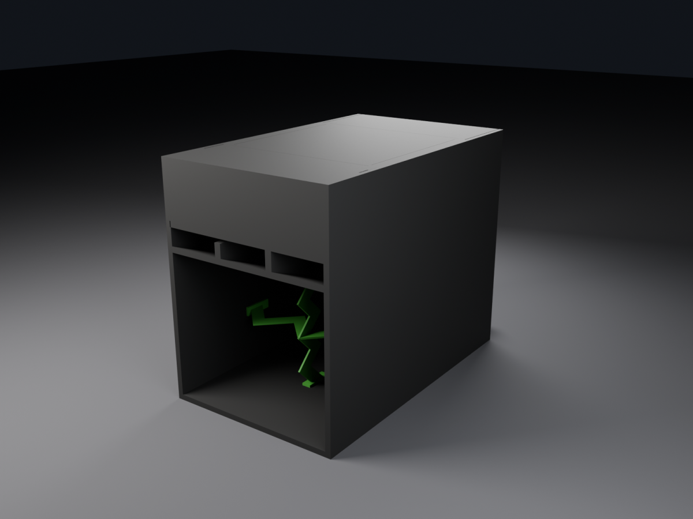

# Published models

Models generated from a spec, committed so that a link printed on paper keeps working. Everything else the builder
writes goes to `build/` and is regenerated on demand. A model belongs here only when something outside this
repository points at it, for example a QR code on a build plan, and that link needs a stable URL.

Unlike [`standalone/`](../standalone/README.md), these are not modelled by hand. Each one is the plain output of
`models:build` for the spec of the same id, copied here together with whatever the outside link expects to find.

| Model | Spec | W × H × D (m) | Files |
|-------|------|---------------|-------|
| [Flexy Folded Horn Hybrid](flexy-folded-horn-hybrid/) | [`flexy-folded-horn-hybrid.yaml`](../specs/speakers/sdwa5/flexy-folded-horn-hybrid.yaml) | 0.591 × 0.763 × 0.964 | `.glb`, preview, build plan EN and DE, cut list CSV |

## Flexy Folded Horn Hybrid



The build plan's cover carries two QR codes. One opens the `.glb` in
[3dviewer.net](https://3dviewer.net/#model=https://raw.githubusercontent.com/SdWa5/3d/main/published/flexy-folded-horn-hybrid/flexy-folded-horn-hybrid.glb),
the other opens this folder. So the file name and the folder name are fixed for as long as printed plans exist.

- `flexy-folded-horn-hybrid.glb` is the SdWa5 build of the cabinet, including its castors and fittings.
- `build-plan-rev-c-en.pdf` and `bauplan-rev-c-de.pdf` are the 26-sheet A3 build plan, revision C of 17.10.2026.
  Revision B added the sheet numbers, part names, the paper size in every scale field and the notes on the optional
  parts. Revision C states the material, 18 mm multiplex, on the cover and on every sheet, and appends sheet 26 with
  the parts list, the cut list and the recommended stock sizes.
- `flexy-cutlist.csv` is the cut list for import into [cutlistoptimizer.com](https://www.cutlistoptimizer.com/), in
  the columns `Length,Width,Qty,Material,Label,Enabled`. Blanks are rounded up to whole millimetres, and the optional
  parts are imported disabled. The lid is cut out of the top panel and has no row of its own.

## Rebuilding

```bash
ddev exec bin/console models:build --id=flexy-folded-horn-hybrid -f
cp build/glb/flexy-folded-horn-hybrid.glb published/flexy-folded-horn-hybrid/
python3 tools/check-glb.py 'published/*/*.glb'
```

The spec uses `meshes/flexy-1to10.stl` as its `mesh_override`. That mesh is not committed, so a checkout without it
builds the generated block instead, and the result must not be copied here.

The build plan is written by `tools/flexy-plan/` over the original plan `tools/flexy-plan/original.pdf`. The parts
data lives in `tools/flexy-plan/parts.json` alone, and the CSV and sheet 26 are both generated from it. The script
needs the Liberation Sans fonts and is byte-reproducible for a given `--date`.

```bash
python3 -m venv tools/flexy-plan/.venv
tools/flexy-plan/.venv/bin/pip install -r tools/flexy-plan/requirements.txt
cd tools/flexy-plan
.venv/bin/python build.py original.pdf ../../published/flexy-folded-horn-hybrid/build-plan-rev-c-en.pdf en
.venv/bin/python build.py original.pdf ../../published/flexy-folded-horn-hybrid/bauplan-rev-c-de.pdf de
python3 parts.py > ../../published/flexy-folded-horn-hybrid/flexy-cutlist.csv
```

## Licence

The Flexy design belongs to MrFlexySMP. The CAD model and the build plan are by Oliver Ripper, and SdWa5 bought them
together with the full rights. They are published here under CC BY-SA 4.0 like the rest of this repository's data.
